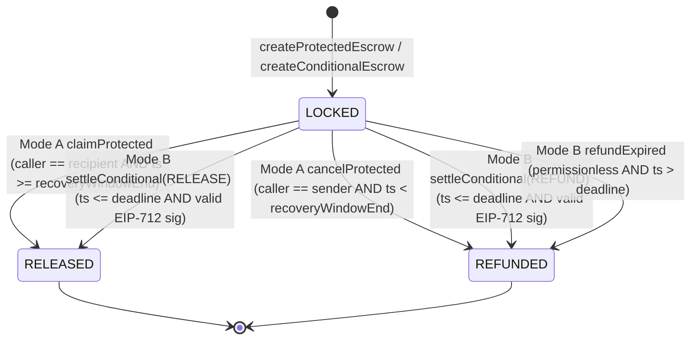

# REVERT Architecture & Escrow State Machine

## System Overview

REVERT separates on-chain custody from off-chain intelligence acquisition and deterministic verification:

1. **On-Chain Escrow Custody ([RevertEscrow.sol](file:///C:/Users/PC/Desktop/Revert/packages/contracts/src/RevertEscrow.sol))**
   - Holds allowlisted ERC-20 tokens (`0xcc194e1a843B658526D0D5C431f670028582Ae17` test USDC on Sepolia).
   - Locks immutable payment terms upon funding (`sender`, `recipient`, `token`, `amount`, `recoveryWindowEnd`, `deadline`, `conditionHash`, `attestor`).
   - Compiled ABI exported at [RevertEscrow.json](file:///C:/Users/PC/Desktop/Revert/packages/contracts/abi/RevertEscrow.json).

2. **Deterministic Policy & Canonical Hashing (`packages/shared`)**
   - Canonicalizes Mode B condition parameters (`ONCHAIN_TX_LOOKUP_GENERAL`) into sorted JSON and computes `conditionHash = keccak256(canonicalJson)`.
   - Evaluates Telegraph responses strictly (`result_shape == "intent"`, `field_status.status == "ok"`, `result.status == "confirmed"`, `fulfillment.status == "complete"`, address/value bounds, verified `signal_hash`).

3. **Reusable Telegraph Client (`packages/telegraph-client`)**
   - Supports Telegraph `escrow` (`eip155:11155111`) and `@x402/fetch` `exact` (`eip155:84532`) with strict network/token/`payTo` allowlists, mutex-protected integer spend accounting, idempotency, and redacted evidence storage.

---

## Escrow State Transition Machine

Every escrow starts in `State.LOCKED` at creation and transitions **at most once** to either `State.RELEASED` or `State.REFUNDED`.

### Boundary Mutually-Exclusive Guarantees

| Mode | Action | Timestamp Condition | Caller | Target State | Recipient of Funds |
|---|---|---|---|---|---|
| **Mode A (Protected)** | `cancelProtected` | `block.timestamp < recoveryWindowEnd` | `sender` only | `REFUNDED` | `sender` |
| **Mode A (Protected)** | `claimProtected` | `block.timestamp >= recoveryWindowEnd` | `recipient` only | `RELEASED` | `recipient` |
| **Mode B (Conditional)** | `settleConditional(RELEASE)` | `block.timestamp <= deadline` & `<= expiresAt` | Any (valid EIP-712 attestor sig) | `RELEASED` | `recipient` |
| **Mode B (Conditional)** | `settleConditional(REFUND)` | `block.timestamp <= deadline` & `<= expiresAt` | Any (valid EIP-712 attestor sig) | `REFUNDED` | `sender` |
| **Mode B (Conditional)** | `refundExpired` | `block.timestamp > deadline` | Permissionless (anyone) | `REFUNDED` | `sender` |

At every boundary (`recoveryWindowEnd` for Mode A, `deadline` for Mode B), release and refund paths are strictly disjoint.
